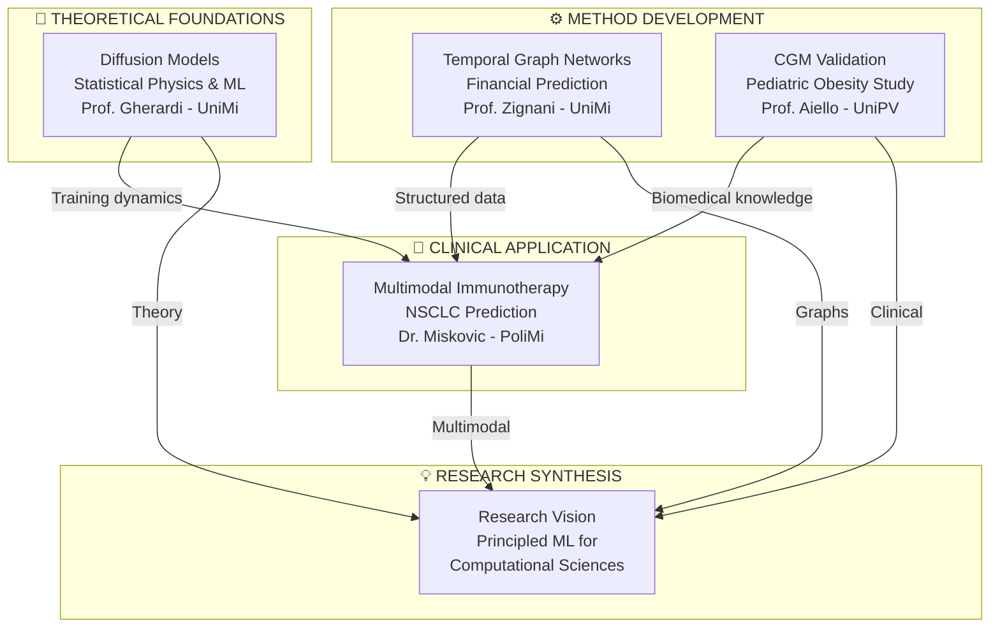
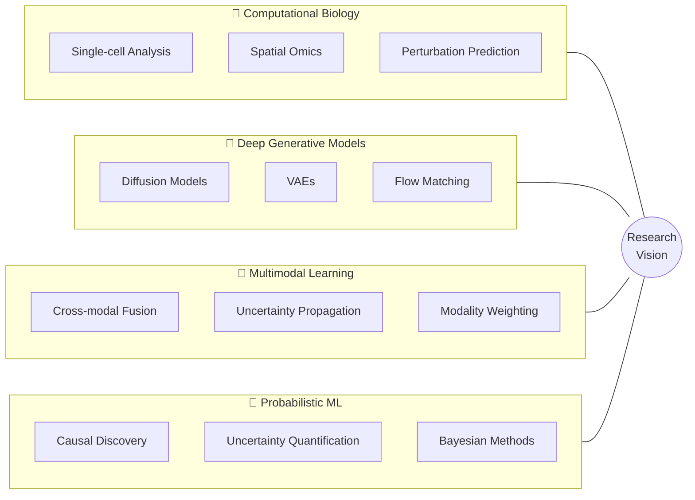

# <div align="center">🧠 Aditya Ravi</div>

<div align="center">


**B.Sc. Artificial Intelligence | Università degli Studi di Pavia**  
📍 Pavia, Italy | 🎓 Expected Graduation: February 2026

[](https://linkedin.com/in/aditya-ravi-a3aab11b6)
[](mailto:adityaravu@gmail.com)
[](https://github.com/adityaravi9034)

</div>

---

##  About Me

I am a final-year AI undergraduate with **four research internships** spanning diverse domains from temporal graph neural networks for financial prediction to multimodal deep learning for cancer immunotherapy. My research journey reflects a deliberate exploration toward understanding **principled machine learning methods** that bridge theoretical foundations with real-world impact.

Currently focused on **computational biology** and **healthcare AI**, I'm particularly interested in deep generative models, multimodal data integration, and uncertainty quantification in high-dimensional biological systems.

I also design **synthetic medical datasets and reproducible benchmark pipelines**, combining procedural imaging, simulated patient trajectories, biomedical text, and controlled evaluation across scientific and language tasks.

> *"Each project was a step toward understanding not just how to apply machine learning, but what fundamental principles govern effective learning from complex data."*

---

## 🧪 Medical & Synthetic Dataset Portfolio

Alongside my research internships, I develop **synthetic datasets, procedural generators, and evaluation tasks** for healthcare AI and broader machine learning research. My work spans medical images, longitudinal patient records, physiological signals, clinical text, molecular representations, scientific simulations, and structured reasoning corpora.

The medical datasets below are **synthetic research benchmarks**. Clinical-data analysis and literature-derived projects are identified separately. Repository links marked **private** require access.

### Medical datasets and biomedical benchmarks

**Medical imaging.** In [RetinaPolyLab](https://github.com/adityaravi9034/retinapoly_lab) (**private**), I generated **10,500 synthetic 192 × 192 RGB fundus images** using procedural retinal anatomy and vessel trees. The dataset includes eight correlated findings, camera appearance variation, rare findings, lesion-instance counts and spatial-summary metadata, distractor artifacts, and label noise. Its tasks span multi-label findings, lesion counting, severity, laterality, referral classification, and uncertainty.

The [FractureCast v2](https://github.com/adityaravi9034/FractureCast_v2) and [v3](https://github.com/adityaravi9034/FractureCast_v3) projects (**private**) cover stylized long-bone radiographs with casts, hardware, foreign objects, subtle fracture-like confounders, and exposure variation. **v2 contains 9,000 synthetic 128 × 128 grayscale images**, including a robustness subset. **v3 extends the same images** into seven classification and regression outputs covering fracture pattern, cast extent, confounders, contrast, and occlusion.

**Longitudinal oncology.** [Immunotherapy Response](https://github.com/adityaravi9034/Immunotherapy-Response) (**private**) simulates patient trajectories by linking baseline demographics, tumor characteristics, treatment regimens, biomarkers, irregular laboratory and ctDNA measurements, numeric radiomics features, and response/survival outcomes. The generator incorporates latent disease dynamics, censoring, non-random observation patterns, missingness, and assay batch effects. The radiomics modality consists of **40 simulated numeric features**.

**Clinical intake and adversarial text.** [Adversarial Clinical Triage](https://github.com/adityaravi9034/adversarial-clinical-triage) (**private**) includes a deterministic generator configured for **200,000 synthetic emergency-intake records** across HL7 v2 messages, FHIR JSON, nursing notes, ASR-style dictation, and barcode payloads. The tasks combine structured clinical extraction and triage with malformed-input and injection detection.

**Clinical and pharmaceutical language.** I generated [ResistoTag](https://github.com/adityaravi9034/1_bio_chall) synthetic microbiology reports for antimicrobial-resistance tagging, with organism identification, susceptibility phenotypes, molecular findings, negation, and distractor isolates. [PharmaSeq v2](https://github.com/adityaravi9034/rag-pharma-challenge) covers fictional drug/adverse-event narratives for structured extraction, per-event causality, severity and onset normalization, interaction-risk reasoning, and redaction. Both repositories are **private**.

**Neural signals and rehabilitation.** [NeuroToken-FT](https://github.com/adityaravi9034/stimulate-brain) (**private**) contains simulated neural-token streams for self-supervised learning and cognitive-state decoding, with subject variation, temporal motifs, nonstationary regimes, artifacts, and dropout. Its generation metadata records **60,000 unlabeled streams and 11,500 labeled trials across 50 virtual subjects**. For [adaptive prosthesis recommendation](https://github.com/adityaravi9034/prosthesis_gait_recsys) (**private**), I built a synthetic gait-telemetry generator combining per-cycle kinematics, IMU and EMG summaries, socket-pressure features, environment, and device state to study adjustment actions and intervention timing.

**Molecular and biological structure.** [BioKatalyst-ARC](https://github.com/adityaravi9034/Non-Canonical-Amino-Acid) (**private**) pairs invented enzyme sequences, noncanonical amino-acid identities, cofactors, substrate representations, and assay conditions with simulated reaction-selectivity targets. [BioStrata](https://github.com/adityaravi9034/biological_composition) (**private**) pairs **72,000 generated biomedical passages** with composition graphs linking anatomy, tissues, cells, organelles, molecules, and elements, with variation through synonyms, coreference, negation, and distractor relations.

**Medical document reconciliation.** [MediCV-Reconcile](https://github.com/adityaravi9034/MediCV-Reconcile) (**private**) uses synthetic physician credentialing bundles to reconstruct career timelines, identify typed conflicts, and produce evidence-linked structured narratives from inconsistent records, OCR noise, multilingual fragments, and stale information.

### Broader synthetic data work

<details open>
<summary><b>Scientific simulation, chemistry, graphs, and computational reasoning</b></summary>

| Area | Datasets and generators I developed | What the data supports |
|---|---|---|
| **Chemical information extraction** | [CHEM-PROC-NER](https://github.com/adityaravi9034/1_chem_challenge) — synthetic experimental procedures with aligned token-level BIO annotations, varied reagent names, work-up distractors, and contextual entity roles. | Named-entity recognition, unseen-name generalization, and robustness to annotation noise. |
| **Molecular reasoning and inverse design** | [CarbonARC](https://github.com/adityaravi9034/carbon_dataset) — support/query analogy puzzles over molecular graphs serialized as SMILES; [POM-Strata](https://github.com/adityaravi9034/Polyoxometalates) — target-property descriptions paired with graph representations of polyoxometalate clusters. | Rule induction, graph transformations, and inverse design under a synthetic structure–property model. |
| **Physics and dynamics** | [Ocean Wave-Language](https://github.com/adityaravi9034/Ocean-wave-equation) — symbolic wave sequences from a gravity–capillary model with sensor dropout; [ClothDrape-S2S](https://github.com/adityaravi9034/Blanket-problelm) — simulated cloth meshes settling on varied terrain; [Rydberg Quantum Oracle](https://github.com/adityaravi9034/Ultracold-Rydberg-Molecule) — simulated molecular binding spectra. | Sequence forecasting, reconstruction from partial observations, and scientific surrogate modeling. |
| **Graphs, arithmetic, and distributed systems** | [SPLITTREE-Hyper](https://github.com/adityaravi9034/Hypergraph-Chromatic-Polynomials) — generated hypergraphs paired with exact chromatic-polynomial coefficients; [QuantumCrypt-Scratch](https://github.com/adityaravi9034/Number-Theoretic-Transform) — instruction/output pairs from a pedagogical modular-arithmetic and lattice-cryptography engine; [Consensus-Oracle](https://github.com/adityaravi9034/Byzantine-Fault-Tolerant-BFT) — simulated local message logs from three consensus protocol families. | Exact computation, structural inference, and reasoning over asynchronous, incomplete observations. |
| **Formal languages and scientific narratives** | [PERIODICA](https://github.com/adityaravi9034/Periodic-Table) — a synthetic reaction language with latent periodic structure and long-range dependencies; [Nuclear Transmutation Narratives](https://github.com/adityaravi9034/uranium) — prose describing symbolic nuclear operations paired with their execution traces. | Self-supervised sequence learning and execution of natural-language instructions. |
| **Music and latent temporal signals** | [Echoes](https://github.com/adityaravi9034/music_chemical_reaction) — symbolic musical events paired with simulated recollection trajectories and peak annotations. | Long-range motif tracking and learning from noisy labels and decoy recurrences. |

All repositories in this table are **private**. The chemical property models, musical response signals, and simulations are defined by their generators; they are controlled research data.

</details>

<details>
<summary><b>Language, document evidence, trustworthy NLP, and task generators</b></summary>

| Area | Examples of my work |
|---|---|
| **Artificial languages and narrative worlds** | [NEW_LANG_DATASET](https://github.com/adityaravi9034/NEW_LANG_DATASET) models symbolic grammar, dialects, speaker variation, and temporal drift for infilling; [Mythweave](https://github.com/adityaravi9034/mythweave_challenge) links fictional civilizations and eras to noisy narratives and multi-hop questions. |
| **Evidence reconciliation and career forensics** | [CV Evidence Reconciliation](https://github.com/adityaravi9034/cv_evidence_reconciliation), [Cross-Document Career Fraud](https://github.com/adityaravi9034/cross_doc_career_fraud_v3), and [Palimpsest-CV](https://github.com/adityaravi9034/palimpsest-cv) connect synthetic career histories, CVs, profiles, references, registries, and supporting documents for correction, citation, contradiction detection, and claim recovery. |
| **Trustworthy research-assistant behavior** | [NEXUS-7](https://github.com/adityaravi9034/nexus7_challenge) links simulated multi-turn queries, retrieval snippets, responses, users, and document histories for citation grounding, hallucination-span annotation, prompt-injection detection, and trust classification. |
| **Financial NLP** | [Earnings-Call Multi-Task NLP](https://github.com/adityaravi9034/Earnings-Call-Multi-Task-NLP-Challenge) generates fictional executive remarks and Q&A with targets for sentiment, risk spans, numerical extraction, guidance, hedging, and consistency across passages. |
| **Operations, practical scenarios, and preferences** | I implemented generators for [ORION-Odyssey](https://github.com/adityaravi9034/orion_odyssey) operations tickets linked to procedures, crew, and equipment; [Rule-of-Thumb](https://github.com/adityaravi9034/Rule-of-Thumb-Dataset) scenario/response pairs; and [Moral Topology](https://github.com/adityaravi9034/Ethics-Bias-Cultural-Nuance) dilemmas with **simulated** cultural-context preference scores. |
| **Code and mathematical reasoning** | I implemented [CodeMorph](https://github.com/adityaravi9034/CodeMorph_Challenge) generators for compositional code transformations across six programming languages, and [SymProve](https://github.com/adityaravi9034/symprove_challenge) generators for proof-like completion and reasoning tasks in a custom symbolic language. |

All repositories in this table are **private**. The final two rows include projects whose committed source provides a generator and task pipeline without a materialized corpus.

</details>

### How I build and evaluate synthetic data

- **Generation and representation:** Seeded Python/NumPy generators, procedural image rendering, numerical simulation, graph construction, and template-based text generation; schemas spanning CSV, JSONL, NumPy arrays, images, and linked records.
- **Controlled variation:** Patient or subject heterogeneity, missing observations, sensor noise, label uncertainty, contradictory documents, distractors, and distribution shifts tailored to the task.
- **Generalization-focused splits:** Depending on the project, separation by subject, entity, vocabulary, template, or transformation family to test behavior beyond repeated examples.
- **Supporting tooling:** Dataset preparation scripts, schema and consistency checks, reference implementations, baseline models, and scoring code where included in the repository.

### Related clinical-data analysis and evidence curation

My [Medical Applications & Healthcare laboratory work](https://github.com/adityaravi9034/Labs-of-Medical-Applications-Healthcare) applies missing-data imputation, mixed-effects models, survival analysis, and dimensionality reduction to existing teaching and clinical datasets. This complements my synthetic-data development with experience analyzing observed data.

In [PROTEUS](https://github.com/adityaravi9034/protein-in-mass-muscle-building-in-body) (**private**), I curated open-access muscle-physiology literature and authored colloquial protein/muscle-building claims for citation-grounded clarification and retrieval. The committed article manifest covers **354 articles and 14,723 passages**; this is a literature-based evidence corpus.

---

## 🔬 Research Connection Map



<details>
<summary><b>📊 How My Research Connects (Click to Expand)</b></summary>

| Research Area | Key Learning | Connection to Academic Goals |
|---------------|--------------|------------------------|
| **Temporal GNNs** (Finance) | Structured data, multi-relational graphs, distribution shift | Foundation for biological graph representations |
| **CGM Validation** (Healthcare) | Clinical validation, inter-individual variability, real-world data challenges | Domain expertise in healthcare AI |
| **Diffusion Models** (Theory) | Training dynamics, noise schedules, closed-loop learning | Theoretical understanding of generative models |
| **Multimodal Cancer ML** (Application) | Cross-modal fusion, uncertainty propagation, interpretability | Integration of all previous learnings |

</details>

---

## 🎓 Current Research Positions

<table>
<tr>
<td width="50%">

### 🧬 AI-ON-LAB, Politecnico Milano
**Research Intern** | Nov 2025 - Present  
*Supervisor: Dr. Vanja Miskovic*

Developing multimodal ML approaches for predicting immunotherapy efficacy in **Non-Small Cell Lung Cancer**:
- Transformer-based fusion architectures
- Contrastive alignment for clinical + genomic + imaging data
- SHAP-based interpretability analysis

</td>
<td width="50%">

### ⚛️ Statistical Physics & ML Group, UniMi
**Research Intern** | Oct 2025 - Present  
*Supervisor: Prof. Marco Gherardi*

Investigating closed-loop learning dynamics in **diffusion-based generative models**:
- PyTorch implementation of diffusion models
- Analysis of noise schedules and coupling parameters
- Statistical physics perspective on ML theory

</td>
</tr>
<tr>
<td width="50%">

### 🩺 ICDS Lab, University of Pavia
**Research Intern** | May 2025 - Nov 2025  
*Supervisor: Prof. Eleonora Maria Aiello*

**CGM validation study** in pediatric obesity:
- Temporal alignment of CGM vs plasma glucose
- MARD, Bland-Altman, and Error Grid analysis
- Clinical classification impact assessment

</td>
<td width="50%">

### 📈 University of Milan, CS Dept
**Research Intern** | Oct 2024 - May 2025  
*Supervisor: Prof. Matteo Zignani*

**Temporal Graph Neural Networks** for NASDAQ prediction:
- Relational TGCN implementation
- Multi-relational edge construction
- Hyperparameter optimization & ranking systems

</td>
</tr>
</table>

---

## 📝 Academic Presentations & Output

### Conference-Style Presentations
- 🎤 **"A Vision-Language Foundation Model for Precision Oncology"** (Nature, 2025) - AI-ON-LAB weekly meeting
- 🎤 **"Heat Death of Generative Models in Closed-Loop Learning"** - Gherardi Group seminar
- 🎤 **"Predicting Changes in Glycemic Control from Wearable Device Data"** - Medical Applications course

### Publications & Manuscripts
- 📄 **CGM vs OGTT Comparative Analysis** - Expected submission Spring 2026
- 📄 **Bachelor's Thesis**: Glucose Response Patterns Based on Macronutrient Composition

---

## 🛠️ Technical Stack

<div align="center">

### Core Languages & ML Frameworks


### ML & Data Science


### Visualization & Tools


</div>

### Specialized Skills
```
🧠 Deep Learning: CNNs, Transformers, VAEs, Diffusion Models, Graph Neural Networks
📊 Statistical Methods: Bayesian Inference, Survival Analysis, Clinical Validation Metrics
🔬 Domains: Computational Biology, Healthcare AI, Quantitative Finance
🧪 Dataset Engineering: Synthetic Data, Procedural Simulation, Annotation Pipelines, Benchmark Design
```

---

## 🎯 Research Interests &  Focus



**Core Questions I'm Pursuing:**
- How should we weight different modalities when they provide conflicting signals?
- What inductive biases are appropriate for cross-modal representation learning?
- How do we rigorously quantify uncertainty when integrating heterogeneous biological data?


## 📫 Let's Connect

<div align="center">

I'm actively looking to work in Machine Learning, Computational Biology, and AI for Healthcare.

Open to discussing research collaborations, opportunities, and innovative applications of ML in biology and medicine.

**Email:** [adityaravu@gmail.com](mailto:adityaravu@gmail.com)  
**LinkedIn:** [linkedin.com/in/aditya-ravi-a3aab11b6](https://linkedin.com/in/aditya-ravi-a3aab11b6)  
**Location:** Pavia, Italy 🇮🇹

---


*"Bridging theoretical ML research with principled applications in computational biology"*

</div>
